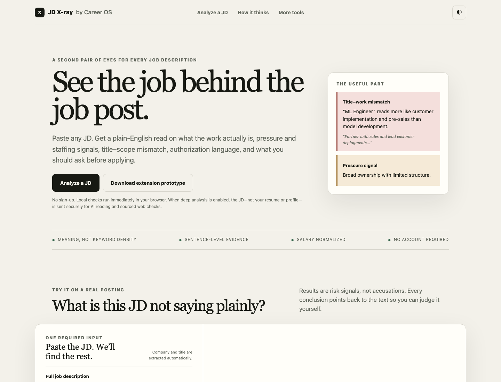

# JD X-ray

After reviewing more than 100 job postings, I kept seeing the same hidden patterns: staffing firms
that never name the real employer, talent-pool pages presented like live openings, research titles
attached to customer-delivery work, and critical pay or work-authorization details left unsaid.

JD X-ray turns those recurring patterns into an evidence-backed second pair of eyes. Paste a job
description and it explains what the work appears to be, what deserves scrutiny, what the posting
does not tell you, and which questions are worth asking before you spend time applying.

**[Try the live demo](https://career-os-public-demo.demianman.chatgpt.site/?v=10)** — no account or
profile required. The immediate analysis runs in your browser.



## One posting, read beyond the title

Consider a posting titled **“Forward Deployed AI Engineer — Agents & Research Systems”** from
**“MaxIT Consulting — Max Corporate Group.”** It promises advanced agent systems for “large
enterprise environments,” but the text never identifies the client or operating employer. Its footer
asks candidates to enter a general talent network for possible future searches.

JD X-ray does not just extract `AI`, `agents`, and `research`. It connects the language into a more
useful decision:

| What the posting says | What JD X-ray surfaces |
| --- | --- |
| “work directly with technically sophisticated customers” | The role is substantially customer-facing deployment, not primarily independent research. |
| End-to-end production deployment ownership | Delivery ownership is central; support, travel, and after-hours expectations should be clarified. |
| “strongly prefers in-person collaboration” while describing flexibility as exceptional | San Francisco on-site work is the default; flexibility is an exception. |
| “Join Our Global Talent Network” and a reference to future searches | This may be a recruiter-managed or talent-pool listing; confirm that the requisition is funded and live, who the client is, and who the legal employer would be. |
| No salary or work-authorization language | Pay, OPT/STEM OPT support, and future sponsorship remain unknown—not assumed positive or negative. |

The resulting questions are specific: Is this a live, funded requisition? Who is the legal employer?
How much of the week is customer implementation or support? How many days in San Francisco are
mandatory? What is the approved base range? Can the employer support OPT/STEM OPT and future H-1B
sponsorship?

That is the product thesis: **turn a scattered posting into evidence-backed risk signals without
pretending the text proves more than it does.**

## What it does now

- analyzes a pasted JD in one click, without an account;
- extracts the likely company and title, then shows confidence rather than hiding uncertainty;
- distinguishes the title from the work actually described;
- flags staffing, talent-pool, pressure, on-site, and work-authorization signals with quoted evidence;
- identifies important omissions instead of silently filling them in;
- normalizes hourly and annual compensation using a visible assumption;
- produces targeted questions for the recruiter or hiring manager;
- ships a downloadable Chrome/Edge side-panel prototype for analyzing a posting in context.

An optional **Deep Check** backend is designed for semantic model analysis and sourced web research.
It is intentionally disabled in the public demo until a provider key and production abuse controls
are configured; the browser-local analysis remains usable without it.

## How it works

The current local engine combines deterministic parsing with meaning-oriented rules. Each finding
must point back to sentences in the posting. Unknowns stay unknown. The extension reads the active
page only after the user clicks it and requests only `activeTab`, `scripting`, `sidePanel`, and
`storage`.

The server-side Deep Check architecture supports structured model output, explicit user activation,
signed anonymous quotas, caching, throttling, concurrency protection, and optional Turnstile
verification. The JD—not a resume or personal profile—is the intended model input.

## Limits, stated after the useful part

- Findings are explainable risk signals, not proof of employer intent or workplace conditions.
- Work-mix percentages measure emphasis in the posting, not guaranteed time allocation.
- Hourly/annual conversion uses 2,080 hours and excludes bonus, equity, overtime, and unpaid time.
- Missing sponsorship language remains unknown. The tool never answers legal or work-authorization
  questions for the candidate.
- Local H-1B history is unavailable until legal-entity matching and official disclosure-data
  ingestion are implemented. Search absence is never treated as proof that an employer has no
  filings or that a role does not exist.
- Public AI activation still requires a provider-side spend cap and bot protection. The included
  in-memory network window is abuse friction, not a global billing guarantee.

## Privacy

The public project is isolated from the private job-search system it originated from. It ships with
no personal profile, resume, application history, private employer notes, API key, or runtime job
data. The default analysis is browser-local, and the repository includes a public-safety scan that
rejects personal markers, absolute local paths, and common secret formats.

See [PRIVACY.md](PRIVACY.md) for the data-flow details.

## Run and verify locally

```bash
npm run build
npm test
npm run preview
```
